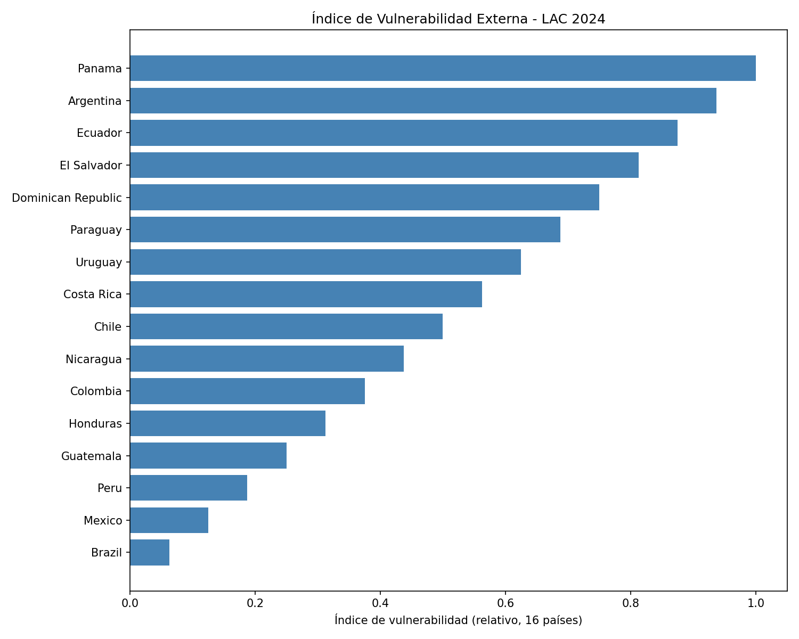

# Monitor Soberano LAC

[](https://www.python.org)
[](LICENSE)
[](https://data.imf.org/en/datasets/IMF.STA:IRFCL)
[](https://monitor-soberano-lac.streamlit.app)

**Monitor de vulnerabilidad externa (IRFCL-FMI) para 16 países de América Latina y el Caribe.**



> **Datos a: 2024** (última observación anual completa disponible en IMF IRFCL).

> ⚠️ **Aviso**: herramienta informativa; no constituye asesoría de inversión.

## El problema

Los países de América Latina enfrentan vencimientos de deuda externa, derivados y otros compromisos en moneda extranjera que pueden drenar sus reservas internacionales. Cuando esos drenajes superan las reservas disponibles, el país queda expuesto a crisis de balanza de pagos, devaluaciones y pérdida de acceso a mercados.

**Monitor Soberano LAC** responde una pregunta concreta: *¿qué países de la región no tienen reservas suficientes para cubrir sus compromisos externos de corto plazo?*

## Para quién

- **Analistas de riesgo soberano** que necesitan una lectura rápida de exposición externa.
- **Investigadores y hacedores de política pública** que monitorean vulnerabilidad externa regional.

## Qué cubre

| Dimensión | Indicador | Fuente | Cobertura |
|---|---|---|---|
| Vulnerabilidad externa | Drenajes predeterminados sobre reservas totales | IMF IRFCL | 16 países |
| Composición del riesgo | Drenajes por instrumento: deuda, derivados, repos, garantías, líneas de crédito, puttable bonds | IMF IRFCL | 16 países |
| Reservas oficiales | Validación cruzada de reservas totales | Bancos centrales (BCRA, BCCh, BanRep, y reservas publicadas de BRA, PER, MEX) | 6 países (2024) |
| Contexto macro | Deuda del gobierno general (% PIB) | IMF WEO | 5 países |

**Países**: Argentina, Brasil, Chile, Colombia, Costa Rica, Ecuador, El Salvador, Guatemala, Honduras, México, Nicaragua, Panamá, Paraguay, Perú, República Dominicana y Uruguay.

## Resultado principal (2024)

| Ranking | País | Índice (relativo) | Ratio crudo drenajes/reservas |
|---|---|---|---|
| 1 | Argentina | 1.00 | -2.06 |
| 2 | Ecuador | 0.93 | -1.11 |
| 3 | Panamá | 0.87 | -1.04 |
| 4 | El Salvador | 0.80 | -0.86 |
| 5 | Rep. Dominicana | 0.73 | -0.43 |
| 6 | Costa Rica | 0.67 | -0.40 |
| 7 | Uruguay | 0.60 | -0.18 |
| 8 | Chile | 0.53 | -0.17 |
| 9 | Honduras | 0.47 | -0.14 |
| 10 | Nicaragua | 0.40 | -0.14 |
| 11 | Colombia | 0.33 | -0.13 |
| 12 | Perú | 0.27 | -0.06 |
| 13 | Guatemala | 0.20 | -0.05 |
| 14 | México | 0.13 | -0.04 |
| 15 | Brasil | 0.07 | -0.01 |

> **Nota metodológica**: el índice es un **ranking relativo dentro de la muestra de 16 países**, no una medida absoluta de vulnerabilidad. Un índice de 0.07 (Brasil) indica el mejor desempeño de la muestra, **no ausencia de vulnerabilidad**. Para la magnitud real, consultar el ratio crudo: en Brasil los drenajes netos representan solo -1.4% de las reservas, mientras que en Argentina superan 2 veces las reservas disponibles.

## Nota sobre economías dolarizadas

**Panamá, Ecuador y El Salvador** no emiten moneda propia y no cuentan con prestamista de última instancia en moneda propia. Sus reservas cumplen una función de liquidez distinta a la de un banco central emisor: un ratio drenajes/reservas elevado indica vulnerabilidad **más severa**, no directamente comparable con la de países con banco central emisor.

## Metodología

El índice se construye con el ratio de **drenajes predeterminados sobre reservas totales** del FMI (IRFCL):

\[
\text{ratio} = \frac{\text{drenajes netos predeterminados}}{\text{reservas oficiales totales}}
\]

- **Drenajes predeterminados** (`RAPFA_USD`): obligaciones en divisa con vencimiento cierto en los próximos 12 meses (amortizaciones de deuda, forwards/futuros, repos).
- **Reservas totales** (`RAFA_USD`): divisa convertible, títulos, oro, DEG y posición de reserva en el FMI.
- **Drenajes contingentes** (garantías, puttable bonds, líneas de crédito no dibujadas, opciones): se reportan y desagregan por instrumento en el dashboard, pero **no entran en el cálculo del índice**.
- **Normalización**: rank percentil del ratio dentro de la muestra de 16 países por año. El ratio más negativo (drenajes que más superan las reservas) recibe índice 1.0.
- **Filtro**: se excluyen observaciones con reservas menores a 100 M USD.

Ver [docs/METHODOLOGY.md](docs/METHODOLOGY.md) para el detalle completo.

## Validación de reservas (2024)

Se calculó el cociente entre las reservas IRFCL (`RAFA_USD`) y las reservas totales publicadas por cada banco central (fuente de referencia):

| País | IRFCL / referencia |
|---|---|
| Perú | 0.99 |
| México | 1.01 |
| Colombia | 0.94 |
| Brasil | 0.93 |
| Chile | 0.89 |
| Argentina | 0.72 |

Los cocientes por debajo de 1 son coherentes con diferencias de cobertura entre la serie IRFCL y las reservas totales publicadas (por ejemplo, tratamiento de oro y DEG según el reporte de cada país). El caso de México (1.01) refleja una diferencia de definición o fecha de corte entre fuentes y se documenta como tal en la metodología.

## Instalación y ejecución

```bash
git clone [https://github.com/rojolimh-byte/monitor-soberano-lac.git](https://github.com/rojolimh-byte/monitor-soberano-lac.git)
cd monitor-soberano-lac
pip install -r requirements.txt
streamlit run dashboards/app.py
```

**Dashboard en vivo**: [https://monitor-soberano-lac.streamlit.app](https://monitor-soberano-lac.streamlit.app)

## Fuentes y frecuencia

- **IMF IRFCL**: actualización mensual/trimestral según país. [https://data.imf.org/en/datasets/IMF.STA:IRFCL](https://data.imf.org/en/datasets/IMF.STA:IRFCL)
- **IMF WEO**: actualización semestral (abril/octubre).
- **Bancos centrales** (BCRA Argentina, BCCh Chile, BanRep Colombia, y reservas publicadas del resto de países para validación): frecuencia diaria/mensual.

## Limitaciones

- La deuda WEO tiene cobertura parcial (5 países) y se usa como contexto, no como componente del índice.
- El índice mide vulnerabilidad de stock; no incorpora flujos futuros de ingresos de divisas (exportaciones, IED, remesas).
- La serie IRFCL puede excluir oro y DEG según el reporte de cada país; las reservas totales publicadas por los bancos centrales incluyen ambos, lo que explica cocientes de validación por debajo de 1.
- El índice es relativo a la muestra de 16 países; no es una medida absoluta de riesgo.

## Próximos pasos

- [x] Dashboard interactivo deployado (Streamlit Cloud) — [ver demo](https://monitor-soberano-lac.streamlit.app)
- [ ] Ampliar cobertura de validación de reservas locales a más países
- [ ] Incorporar spreads de CDS y calificaciones crediticias
- [ ] Backtesting sistemático contra episodios de crisis
- [ ] Alertas automáticas cuando el índice supera umbrales

## Licencia

MIT
